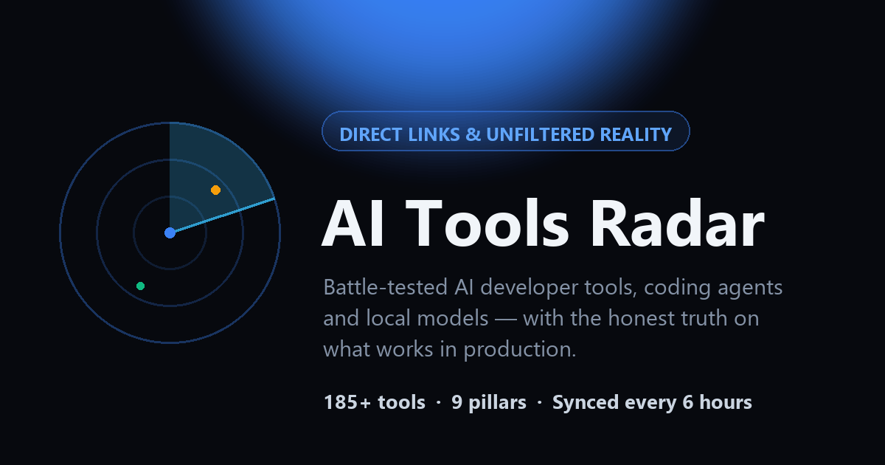

# 📡 AI Tools Radar

**Live site: [vickeyviswanathan.github.io/ai-tools-radar](https://vickeyviswanathan.github.io/ai-tools-radar/)**

An open, independent directory of battle-tested AI developer tools, coding agents, and local models — with direct links and the unfiltered truth on what actually works in production.



## What's inside

- **Curated Tools Directory** — 185+ tools across 9 pillars (Coding, Agents & Automation, Image & Design, Video, Audio & Voice, Chat & Assistants, Productivity, Research & Data, Models & Infra), searchable and filterable, with card/list layouts.
- **8 Production Realities** — the hard technical mechanisms behind why AI projects fail in production, each with the vendor pitch, the engineering truth, the business impact (₹), and proven tools that solve it.
- **Executive Brief** — the 3 costliest traps translated into business terms, front and center for leaders.

## How it stays fresh

A GitHub Action runs every 6 hours (`.github/workflows/deploy.yml`) and:

1. **Ingests** from 100% permitted open sources — Hacker News (Algolia API), GitHub Search API, Hugging Face Hub API.
2. **Filters** through a quality gate (`src/quality.mjs`): minimum traction thresholds, anti-wrapper/anti-junk patterns, brand-safety blocklist, non-English cleanup, promo-fragment stripping.
3. **Ranks** by real popularity signals (GitHub stars, Hugging Face likes, HN points) with decay velocity.
4. **Publishes** `public/data/tools.json`, pre-renders all tool cards into `index.html` for SEO/no-JS visitors, injects JSON-LD structured data, and regenerates `sitemap.xml` / `robots.txt` (`src/seo-publish.mjs`).
5. **Deploys** to GitHub Pages.

## Local development

```bash
npm ci
node build-static.mjs   # optional: refresh data (hits public APIs)
npx serve public        # or any static server; open http://localhost:3000
```

There is also a standalone server mode (`server.mjs`, port 4317) with SQLite storage (`node:sqlite`) and a submission endpoint, but the public site is the static GitHub Pages build.

### Configuration (server mode / ingestion)

| Variable | Default | Description |
|---|---|---|
| `PORT` | `4317` | Web server port (server mode) |
| `INGEST_INTERVAL_MIN` | `60` | Background sync frequency (server mode) |
| `GITHUB_TOKEN` | *(optional)* | Unlocks high-rate-limit GitHub search |

## Project structure

- `public/index.html` — the whole frontend (no framework, no build step)
- `public/data/tools.json` — generated data feed consumed by the frontend
- `build-static.mjs` — CI build: ingest → rank → publish → deploy
- `src/quality.mjs` — quality gate, anti-junk filters, editorial summaries
- `src/seo-publish.mjs` — static pre-render, JSON-LD, sitemap, robots.txt
- `src/sources*.mjs` — HN / GitHub / Hugging Face API adapters
- `src/ingest.mjs` — ingestion pipeline, dedup, trending score
- `src/featured.mjs` — hand-picked editorial entries

## Suggest a tool

Open an issue: [github.com/vickeyviswanathan/ai-tools-radar/issues/new](https://github.com/vickeyviswanathan/ai-tools-radar/issues/new)

## Author

Built by **Vivek Viswanathan** — [LinkedIn](https://www.linkedin.com/in/vickeyviswanathan)

## License

[MIT](LICENSE)
